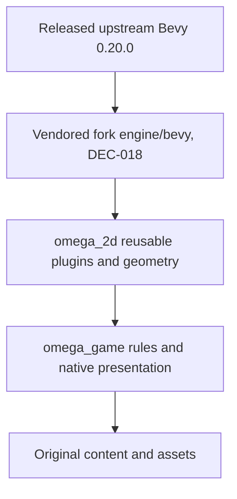

# Architecture and engineering contracts

Status: **APPROVED by owner blanket approval of draft/proposed artifacts, 2026-10-24.** No Rust workspace or implementation is created by these documents. [GDD](../gdd.md) and [Art Bible](../art-bible.md) own product rules. Architecture choices are accepted original design recommendations; external facts are dated in the [source ledger](../research/sources.md#stage-4-verification). Build compatibility and performance remain unverified.

## 1. Repository and dependency direction

Use the existing repository and one Cargo workspace, resolver 3, with two packages:

- `crates/omega_2d`: reusable geometry, logical camera and visual-catalog/presentation facilities needed by this game. Its concrete reuse case is another bounded 2D sprite game; it contains no waves, weapons, scrap, stat formulas, unlocks or profile rules.
- `crates/omega_game`: game library and binaries `omega-game` (native client), `omega-content` (validation CLI) and `omega-sim` (headless scenarios/measurement). These binaries share the same game library; they are not independent engine implementations.

The crate boundary allows a headless consumer and a future game to use engine contracts without importing game content. Other features are modules, not new crates. A separate engine repository adds coordinated releases and Git dependency management before a second consumer exists; defer it. No published crates or public semver commitment yet; both packages use `publish=false` until licensing/API publication is decided.

Arrows above express the five conceptual layers; Rust dependency direction is `omega_game -> omega_2d -> Bevy`, never back toward the game. Content is loaded by game/presentation consumers and cannot execute arbitrary scripts. An empty fork-patch layer does not require an empty crate. Under DEC-018 the root manifest's `[patch.crates-io]` section points every Bevy crate to the vendored fork in `engine/bevy/` ([ADR-012](adr/012-vendored-bevy-fork.md)). Each engine change is logged in the [engine patch log](../../engine/README.md#patch-log) with its test. Separate engine repo extraction remains reversible after a proven second consumer.

Planned paths: `crates/omega_2d/src/{geometry,camera,visuals}/`, `crates/omega_game/src/{content,sim,input,combat,encounters,shop,progression,persistence,ui,audio,diagnostics}/`, corresponding `tests/`, `assets/content/`, the Art Bible asset paths, `scripts/`, `.github/workflows/`, and `docs/validation/evidence/`. These are allowed future paths, not files to scaffold during planning. Existing local Node/AI-memory setup is not a game dependency or CI prerequisite.

## 2. Toolchain, features and build policy

Recommendations grounded in E4-01–E4-08: pin Rust **1.99.1**, edition 2024, and project MSRV **1.99.1** initially. Bevy's manifest declares a lower minimum; the project does not promise that lower floor. Pin `bevy = "=0.20.0"`, `serde = "=1.0.229"` with derive, `serde_json = "=1.0.154"`, `rand_chacha = "=0.10.0"` and `sha2 = "=0.11.1"` as direct dependencies (refreshed to latest stable under [DEC-015](../decisions/decision-register.md#dec-015--dependency-and-tool-pins-refreshed-to-latest-stable); originally serde 1.0.228, serde_json 1.0.145, rand_chacha 0.9.0). Use `rand_chacha`'s re-exported RNG traits to avoid an unnecessary direct rand dependency. These releases were checked, not proven compatible by a project build. Bootstrap resolves the transitive graph, commits Cargo.lock and runs license/advisory checks before reporting a usable build. No extra dependency may be silently added to solve a compile problem; propose the narrow change with evidence.

Disable Bevy default features at the workspace dependency. Core/headless requirements use `std`, `multi_threaded`, `bevy_state`. `omega_game` default feature `client` adds Bevy `2d`, `ui`, `audio` and `omega_2d/client`; `omega_2d/client` enables its camera/visual integration and Bevy `2d`. Rendering/UI/audio modules are gated by `client`. The graphical binary requires that feature; content/sim binaries do not. The selected profiles are present in the v0.20.0 manifest (E4-01), but their resolved graph must be inspected for unnecessary packages during bootstrap. No 3D profile or runtime SVG renderer is required.

Commands always identify the feature mode; `--workspace` alone does not prove headless isolation. Test the core with `cargo test --workspace --no-default-features --locked` and client build separately with `cargo check -p omega_game --features client --locked`. A headless scenario cannot initialize a window, audio device or renderer even if the host has one. Cargo.lock covers both supported feature modes. Initial developer linking uses the supported MSVC default; benchmark cold/warm builds before choosing dynamic linking, alternative linkers or profile overrides. Release artifacts never rely on development dynamic linking. No custom allocator, pooling framework or universal asset framework is justified yet.

Use rustfmt, Clippy with `-D warnings`, workspace `unsafe_code=forbid`, and ordinary Rust tests. Avoid blanket pedantic lint churn and unexplained suppressions. Pin cargo-deny 0.20.2 (DEC-015; originally 0.18.4) for advisory/license/source checks (E4-11). Initial code-dependency allowlist: MIT, Apache-2.0, BSD-2-Clause, BSD-3-Clause, ISC, Zlib, Unicode-3.0 and BSL-1.0; unlisted terms require review, not automatic denial of the whole project. Asset/font licenses have a separate provenance audit. Dependency/security exceptions require a recorded owner decision. Benchmarks use the scenario executable initially, without Criterion. Generated invariant tests use fixed seed matrices; add a property-testing dependency only for demonstrated shrinking/coverage value.

## 3. Engine contracts

| Contract | Owned data / public boundary | Consumer and invariants | Failure/test/performance |
| --- | --- | --- | --- |
| `ENG-GEOM-001` | `Circle`, `Capsule`, `Bounds2`, finite LU vectors; pure circle overlap, point-segment distance, swept-circle TOI and boundary clamp queries. | Game combat/movement; inclusive tangency, t in [0,1], deterministic tie handling delegated to game IDs. No HP/team/rules inside geometry. | Reject nonfinite/negative radii; degenerate segments supported. Golden edge cases and generated symmetry/translation tests. Initial brute-force candidate search; measure before a spatial index. |
| `ENG-CAM-001` | Fixed-aspect viewport and inverse screen/world mapping from explicit world bounds, actual viewport and camera presentation transform. | Input and rendering; round-trip coordinates, ignore letterbox bars, same extent at different resolutions. | Invalid dimensions return typed error; corner/center round-trip tests. Recompute on resize/settings change, not per entity. |
| `ENG-VIS-001` | Typed `VisualId`, validated catalog/clip metadata, lookup/fallback and projection of logical pose/phase facts to sprites. | Game presentation; IDs independent of file paths/atlas slots. Gameplay never reads image dimensions, frame completion or renderer handles. | Essential-cue failure pauses through game error handling; cosmetic fallback remains visible. Catalog/skin-swap tests; record texture/draw metrics before packing/instancing decisions. |

APIs above name project concepts, not unverified Bevy methods. Stage 4 approval authorizes these boundaries for later implementation; specs require compiling against tagged Bevy APIs and prohibit silently inventing API calls. Contract-breaking changes require a change request and synchronized consumer specs before parallel work resumes.

## 4. Game module map

Each row specifies responsibility, owned state, inputs/outputs, public interface intent, failures, tests and performance concerns. Types are design contracts to implement, not claims of existing code.

| Module | Responsibility / owned data | Inputs, public interface and outputs | Failure, test and performance notes |
| --- | --- | --- | --- |
| `content` | Typed catalogs and immutable `ContentSnapshot {revision, catalogs}`. | Load JSON bundle -> `Result<ValidatedContent, ContentErrors>`; resolve stable IDs, build run pool. Outputs validated references and revision. | Reject duplicate/unknown IDs/fields and GDD schema errors; fixture tests and content CLI. Parse at Boot/Menu, never per hit. |
| `sim` | `RunState`, `SimTick`, monotonic `SimId`/`AttackId`, `RunSeed`, named RNG streams, `RunMetrics`, transition intents. | `GameSimPlugin`, `step(TickInput)` in harness, immutable `RunSnapshot` and ordered presentation records. | Invalid transition leaves state unchanged; seeded traces/state tests. No wall-clock/renderer dependency; explicit flush boundaries. |
| `input` | Raw device frame state, action bindings, pending digital edges, last aim/source, tick intent. | Frame device sample + camera inverse -> `TickInput {move, aim_mode, aim_direction}`; separate UI intents. | Focus/disconnect pause before sim advance; consumed edges do not repeat across catch-up ticks. Device/harness tests; no polling per entity. |
| `combat` | Actor `Health`, `Stats`, `Body`, `Loadout`, weapon timers, `Projectile`, `PendingAttack`, accepted-hit/death sets. | Validated content + tick intents + geometry -> damage intents, deaths, pickup spawns and phase records. | Checked arithmetic; no double rewards/hits. Unit formulas, integration swept hits and i-frame tests. Stable sorted candidate/hit order; initial all-pairs measurement. |
| `encounters` | `WaveRuntime`, `SpawnWarning`, enemy/boss AI phase and authored schedule cursors. | Tick, player pose, catalogs -> spawn/intent/attack requests, completion eligibility. | Boss pending blocks completion; retry/cancel policy explicit. Schedule/boss tests. Fixed enums avoid per-phase component churn. |
| `shop` | `ShopVisit`, offers with stable offer IDs, one-refresh flag and transaction revision. | `ShopCommand` -> `ShopOutcome` or typed rejection; atomically update build/currency/RNG. | Invalid/duplicate commands have no effects. Exhaustion/price/replacement tests. Tiny bounded catalogs; no optimizer/auction framework. |
| `progression` | Grants, run-start unlock snapshot, completed-result identity and challenge evaluation. | Completed-wave/result facts -> idempotent grants and `SaveRequest`. | Death priority before challenge grants. Initial/full pool and repeat-result tests. No lifetime power stats. |
| `persistence` | Versioned profile/settings envelope, save generation, write status/recovery state. | Snapshot -> save protocol; load -> validated profile/recovery dialog. No active run serialized. | Interrupted writes, corrupt/newer version, permission failures; injected filesystem tests. Serialize outside combat mutation; ordered writes cannot overwrite newer generation. |
| `ui` | View models, focus/navigation, shop confirmations, settings and error overlays. | Read-only snapshots + user actions -> typed UI/shop/transition commands. | Never changes HP/scrap directly. UI state and native keyboard/controller checks. Rebuild text when values change; profile before UI pooling. |
| `audio` | Cue-ID to cleared asset mapping, playback handles and channel settings. | Accepted presentation records -> cosmetic playback; state exits stop loops. | Missing device/cosmetic file does not alter sim. Cue counts/native mix tests. Measure voice pressure; visual warning never depends on audio. |
| `diagnostics` | Scenario CLI, snapshot trace, timings/counters and report metadata. | Fixed scenario+seed+input -> CSV/JSON reports, trace comparisons. | No unobserved metric filled with zero; report Unsupported. Benchmarks separate from pass/fail. Disabled in shipping default except actionable error details. |

## 5. ECS state, scheduling and data flow

Core components use fixed shapes: `SimId`, `Pose2`, `PreviousPose2`, `Body {radius}`, `Team`, `Health`, plus role-specific `Player`, `Enemy {definition_id, ai_state}`, `Projectile`, or `Pickup`. Player holds a four-element loadout value; items/stat recomputation happen on purchase, not each tick. Phase enums live inside components to avoid adding/removing markers every windup. This is a baseline design, not an archetype-performance claim. Renderer components live only on presentation entities mapped by SimId; they cannot be queried by authoritative systems.

Use Bevy `FixedUpdate` at 60 Hz to call the ordered game tick while `RunState=Wave` and unpaused. A dedicated `GameTick` schedule contains ordered sets: `Spawn -> Intent -> Movement -> Emit -> Collide -> Resolve -> CollectHeal -> Transition -> Publish`. The harness invokes exactly this schedule N times without a display loop. Explicitly flush deferred spawn/despawn changes at documented boundaries before dependent queries. Spawn/intent/attack ID assignment sorts actors by SimId and weapons by slot index; never rely on ECS iteration/archetype or hash-map order. Same-tick spawned pickups are available before CollectHeal.

Sample device input before the fixed loop, retain held state for every tick and consume digital edges once. UI actions are consumed by the UI/transition layer, not replayed per fixed tick. Focus loss/disconnect sets pause before another tick; pause means no gameplay RNG/timer consumption even if rendering continues. On unpause discard stale accumulated input edges; do not catch up the wall time spent paused. Architecture tests must explicitly cover a frame with zero fixed ticks and one with multiple fixed ticks.

One tick collects hit candidates into transient vectors, resolves in GDD order, marks dead entities immediately, then removes them at the flush boundary. Body-contact candidates are generated in enemy SimId order and receive deterministic attack IDs. An attack's own collision set is fixed before applying its knockback; later attack sets see updated positions. A terminal transition records a result once and disables further wave processing. No buffered presentation message is authoritative for currency, HP, grants or state transitions.

Use explicit transient resources for same-tick `AttackRequests`, `HitCandidates`, `DeathFacts` and `TransitionRequests`; clear/drain them at defined stages. Use a run-owned queue of `PresentationRecord {sequence,tick,kind,payload}` for emission/hit/death/warning events, drained after all ticks in a rendered frame. It must survive multiple fixed ticks and be empty after consumption, avoiding accidental reliance on Bevy message-retention timing. Clear on run teardown; headless harness drains into traces. Bevy observers/messages may implement client-local UI interactions, but lifecycle choices cannot discard authoritative events. Persistent HUD reads current snapshots, not a replay of messages it may have missed.

## 6. RNG and determinism

Use `ChaCha8Rng` from pinned rand_chacha for reproducible same-build tests. Run seed is 32 bytes. Pin getrandom at its latest stable release when native run creation is implemented (DEC-015; originally 0.3.4) and use its checked `fill` operation for native run creation (E4-09); failure returns a readable Start error without creating a partial run. Headless/scenario constructors require explicit seed bytes. No seed security guarantee is needed by an offline game.

Create independent streams by copying the seed and XORing the final byte with fixed tags: spawn types=1, spawn anchors=2, shop=3, crit=4. This is domain separation for game reproducibility, not a cryptographic protocol. Use integer rejection sampling from `next_u32` for unbiased bounded choices; never `% n` alone. Pool order is stable ID order before sampling. Invalid shop actions consume no draws. Cosmetic variation uses a separate non-authoritative source and cannot consume these streams.

Trace sorted authoritative state: tick, logical positions/HP, active IDs, loadout/energy, currency, wave/AI phases, grants and RNG positions. Supported goal is identical trace in the same executable, target/CPU configuration, content revision, seed and tick-input stream. Even that is a claim only after tests pass. No cross-CPU/platform/version bitwise guarantee, rollback networking or user replay compatibility. Geometry uses finite f64 LU calculations initially; damage/economy percentages use checked integer/rational arithmetic to avoid floor/ceil drift. Content decimals convert to exact declared units before simulation. Do not quantize world positions to pixels.

## 7. Data, saves and hot reload

Content format: versioned UTF-8 JSON, typed Serde records, closed tagged enums, reject unknown fields, no arbitrary expressions/scripts. One catalog file per content family under `assets/content/`; `manifest.json` gives schema version and expected files. Validation builds an immutable snapshot; stable IDs remain names, not array offsets. Runtime mods are excluded. Development reload is an explicit Menu action: validate a complete candidate bundle and swap only on success; never mutate an active run. Presentation skin replacement likewise requires complete validated catalogs at a safe state.

Profile/settings format: separate JSON documents with schema_version=1, generation, payload and integrity hash. A small manifest names active generation; two rotating generation files preserve the previous valid copy. Write new inactive generation to a temporary sibling, flush file, reopen/parse/check it, publish the new manifest through a tested Windows replace adapter, then retain the previous valid generation. If interruption corrupts the manifest, scan both slots and choose the highest fully validated generation, exposing recovery status. Never assume overwriting rename is portable or guarantees power-loss durability. Exact OS calls are implemented/tested by SP-010; the requirement is recovering the last valid committed or fully validated newer generation, never silently resetting progress.

Use `%LOCALAPPDATA%/ProjectOmega` on Windows; missing/unwritable location is an actionable persistence error, never a fallback to the executable directory. Tests inject a temporary directory. Payload limits: 1 MiB per profile/settings document as a defensive parsing limit, unrelated to performance budgets. Reject unsupported future schema versions while preserving original bytes. Initial v1 has no historical migration; future migration works on a copy with source/destination fixtures. Profile grant IDs are authoritative; availability is derived on load. Settings stay independent of profile reset. Pin sha2 0.11.1 (DEC-015; originally 0.10.9) for SHA-256 of the serialized payload bytes, also reusable for content/export manifests (E4-10). Hashes detect accidental corruption, not cheating/authenticity. Use `std::fs::rename` for same-directory publication (E4-12), checking every error and validating interrupted writes on Windows; the two-slot protocol supplies recovery rather than an unsupported universal atomicity claim.

## 8. Performance and validation

[Performance plan](performance-plan.md) owns scenarios, hardware, measurement and budget policy. [Quality gates](../validation/quality-gates.md) own commands/acceptance layers; [Definition of Done](../validation/definition-of-done.md) owns completion evidence. No live build, asset conversion or benchmark was run during Stage 4 documentation. [Spec index](../specs/index.md) covers every GDD/Art requirement; implementation task mapping is in [ROADMAP.md](../../ROADMAP.md). No spec is READY merely because its prose exists.

## 9. Substantial decisions

Read ADRs [001](adr/001-bevy-strategy.md), [002](adr/002-toolchain-msrv.md), [003](adr/003-workspace.md), [004](adr/004-collision.md), [005](adr/005-assets.md), [006](adr/006-content.md), [007](adr/007-saves.md), [008](adr/008-input.md), [009](adr/009-ci.md), [010](adr/010-agent-workflow.md) and [011](adr/011-simulation-rng.md). They record alternatives/consequences/reversal costs without duplicating catalogs or formulas. Any unresolved dependency adapter in this document is an explicit task acceptance item; no spec may enter READY while its implementation requires an unapproved product or architectural choice.
