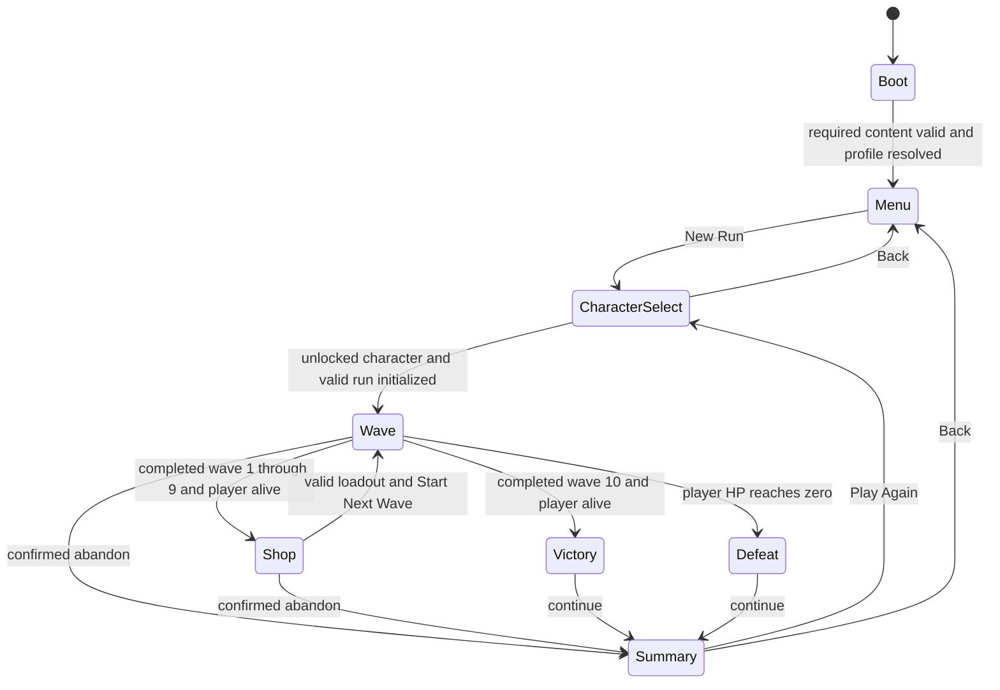

# Project Omega — Game Design Document

Status: **APPROVED explicitly by the owner on 2026-10-24.** Revision: 2 (CR-001 and CR-002 under DEC-014, 2026-10-24: exact rate units and boss request tick; no balance value changed). Stage 2 was approved on 2026-10-23; the owner then directed Stage 4 and explicitly approved both design documents. Numeric P values remain provisional for balance validation. Implementation still requires a completed, authorized Stage 5 roadmap in addition to Stage 4 approval.

## 1. Authority, evidence and interpretation

**Verified:** the approved product choices are recorded in the [decision register](decisions/decision-register.md), with the prior conversation consolidation available at [repository revision 6396617](https://github.com/AlexGalhardo/project-omega/tree/6396617) (accessed locally 2026-10-23). The owner authorized recommended defaults instead of further brainstorming and subsequently approved Stage 2. The canonical approved content counts remain in [scope](decisions/scope-and-non-goals.md#approved-content-envelope).

**Recommendation / original design:** every rule, content identity, formula and numeric value newly specified here is an original proposal for approval with this document. A value marked **P** is a provisional balance value, not a measured result. Unless explicitly marked as an approved owner constraint, all catalog numbers are P. Approval establishes a design baseline; later playtesting must establish quality and balance. **Unknown:** actual difficulty, run duration distribution, production cost and runtime performance. No game or gameplay test exists yet.

Research context and citations, versions and access dates live in the [source ledger](research/sources.md), [gameplay research](research/01-gameplay-reference.md) and [Rust/architecture research](research/04-rust-architecture-and-tooling.md). No formula below is asserted to reproduce Brotato. The [IP policy](legal/ip-policy.md) applies. The [Art Bible](art-bible.md) owns visual/audio production; this GDD owns all simulation geometry, timing, controls and UI behavior. Stable requirement IDs `GDD-001` through `GDD-020` are reserved below for later traceability into specs and tasks.

## 2. Concept, pillars and limits — GDD-001

Scrap-built robots survive ten combat waves in a sealed industrial test arena. Between waves the player spends collected scrap and allocates a six-point reactor among four weapons. The fantasy is rebuilding a small machine into a coordinated arsenal under pressure. `Project Omega` remains a working title; these names have not undergone release-name clearance.

Pillars:

1. **Readable survival:** movement and visible attacks determine whether the robot survives.
2. **Power allocation:** reactor capacity makes equipping a weapon different from powering it.
3. **Compact build decisions:** purchases, upgrades and power distribution happen during a safe interval.
4. **Variety without permanent power:** character starts and challenge unlocks broaden future choices.

Approved constraints: Windows 1.0; one arena, one mode, four characters, twelve base weapons, ten common enemy types, two bosses and forty passive items. One difficulty level. Automatic fire and aim, with optional manual aim. No mandatory paid service. The reusable engine layer must serve these requirements; game rules belong outside it.

Proposed non-goals for 1.0: multiplayer, leaderboards, daily challenges, replay compatibility, procedural terrain, destructible terrain, crafting, inventory grids, story campaign, XP/level-up choices, permanent attribute upgrades, active abilities, run-resume saves and mod loading. Additional difficulties and run-resume may be reconsidered after 1.0; they are not promises. Release model, storefront, license, final title and minimum hardware remain explicitly deferred in DEC-010.

## 3. Complete loop and run lifecycle — GDD-002

1. Boot validates required content and loads settings/profile; show the main menu.
2. Choose an unlocked character. Show its starting weapon and modifier. Start creates a fresh run with zero scrap, base stats plus the character modifier, tier-1 starting weapon in slot 1, three energy points on it and three unallocated points. Run RNG state is initialized from a newly generated seed; debug tooling may supply a seed later.
3. Move and survive a wave; weapons fire automatically when their firing conditions hold. Collect scrap from defeated enemies.
4. On successful wave completion, collect all remaining scrap pickups, discard remaining enemies/projectiles without kill rewards, evaluate challenges and enter the shop. After wave ten, go directly to victory instead.
5. Buy weapons/items, optionally pay for one refresh, and distribute reactor points. There are no time limits in the shop. Start the next wave explicitly.
6. Restore HP to current maximum and reset transient combat state on each wave entry. Purchases, tiers, items, scrap, energy and run metrics persist. Death ends the run and discards the build and unspent scrap.
7. Victory/defeat leads to a summary with wave reached, active combat time, kills, collected/spent scrap, final build and earned unlocks. Return to selection or menu.

**Pacing proposal P:** ordinary waves last 60 seconds. Boss waves also require at least 60 seconds and the boss's death. Ten waves therefore require at least ten minutes of active combat; shops and any surviving bosses add time. This is a mathematical lower bound, not a measured typical run length. Simulation pauses in menus and the shop; UI animation may continue. No fixed release date or measured development throughput is claimed.

## 4. State machine and transition guards — GDD-003



| State / overlay | Entry and owned behavior | Exit guard / failure behavior |
| --- | --- | --- |
| Boot | Validate content references and load local data; show progress. | Required gameplay content invalid: error screen with readable failure and Retry/Quit; do not start a partial run. Missing optional cosmetic asset uses fallback defined in the Art Bible. Profile load failure follows section 14. |
| Menu | New Run, Unlocks, Settings, Credits, Quit. | New Run enabled after Boot succeeds. |
| CharacterSelect | Browse four characters; show locked challenge details; preview starting weapon/modifier. | Start only with an unlocked, valid character. Cancel returns to Menu. |
| Wave | Advance combat tick and wave counters. | Resolve all tick effects, then death before completion. A dead player cannot transition to Shop/Victory even if the boss dies in that tick. |
| Shop | Freeze combat; show offers, inventory, energy and Start Next Wave. | At least one equipped powered weapon; energy sum at most six; slot values 0–3; all content valid. Unspent energy is permitted and visibly warned, without blocking start. |
| Victory / Defeat | Freeze combat, settle result once, display outcome and newly earned unlocks. | Continue opens Summary; duplicate input cannot settle twice. |
| Summary | Show immutable result, save status and navigation. | Play Again opens selection; does not silently restart. |
| Pause overlay | Available in Wave; freeze every gameplay timer, projectile and RNG consumption. Resume, Settings, Abandon. | Resume on explicit input only. Focus loss or controller disconnection while controller is active automatically pauses. |
| Settings overlay | Available from Menu, Shop or Pause; underlying gameplay remains frozen. | Back restores the preceding screen and focus. |
| Abandon confirmation | Explicit confirmation from Wave/Shop; cancel restores prior screen. | Confirm ends run as Abandoned, keeps already earned unlocks, discards the build. No defeat/victory challenge is awarded. |

Wave completion requires `elapsed_ticks >= duration_ticks`; on waves five and ten additionally require the scheduled boss to have spawned and died. Cancelled or pending boss spawns never count as a kill. When ordinary time expires, all remaining enemies may be alive; survival completes that wave. At boss-wave time expiry common spawning stops; surviving common enemies continue until the boss condition also holds. No shop follows wave ten. Result settlement and challenge grants are idempotent.

## 5. Space, movement and input — GDD-004

All values in this section are P. World coordinates use logical units (LU), +X right, +Y up. The single arena `arena_foundry` has playable rectangle `[-600,600] x [-337.5,337.5]` LU. The camera shows that complete rectangle at a fixed 16:9 aspect ratio, with letterboxing for other aspect ratios. UI uses the safe visible region; there is no camera follow, zoom input or scrolling terrain. Walls are solid boundaries with no internal obstacles or pathfinding.

The player has a circular hurtbox of radius 14 LU and base movement speed 180 LU/s. Clamp the center within the arena inset by its radius. Digital diagonals normalize to unit length. Analog movement applies a radial dead zone of 0.20, maps the remaining magnitude linearly to 0–1 and caps magnitude at one. Movement has immediate speed changes, with no acceleration, dash or inertia. Enemy bodies do not block the player or one another; their hurtboxes remain independent, and overlapping attacks obey the damage rules. Visual overlap/readability must be playtested before proposing separation forces.

| Action | Keyboard/mouse default | Controller default | Behavior |
| --- | --- | --- | --- |
| Move | WASD; arrow keys as alternate | Left stick | Normalized world movement. |
| Manual aim | Hold right mouse button; cursor position in world | Right stick beyond radial dead zone 0.25 | Automatic firing continues; one direction is shared by all powered weapons. Release returns immediately to auto aim. |
| Pause / Back | Escape | Menu / face East for UI Back | Never also buys or starts a wave. |
| UI navigate | Arrows/Tab, Shift+Tab; mouse | D-pad/left stick | Visible focus; repeat delay 0.35 s, then 0.12 s (P UI timings). |
| UI confirm | Enter/Space or left click | Face South | One action per press, no held-button purchase repeats. |
| Open energy panel in Shop | E | Shoulder Right | Focuses allocation controls; no combat action. |

Mouse manual aim uses the vector from player center to cursor after inverse camera mapping, not raw screen coordinates. Ignore cursor points in letterbox bars. A vector shorter than 1 LU retains the last valid direction; default last direction is +X. Controller aim is normalized after its dead zone; stick magnitude does not alter fire rate. Default manual aim is hold/stick-based; an optional toggle mode is specified in section 15. Input source switches on deliberate gameplay/UI actions, not passive mouse movement. Gameplay actions are disabled while UI consumes input; confirmation of Start cannot fire a purchase or leak into pause.

Controller support and accessibility are recommendations presented for approval with this GDD, as allowed by DEC-010; no native controller validation has occurred. Screen size, minimum GPU and supported Windows floor require later platform validation.

## 6. Simulation and attack semantics — GDD-005

**Original design recommendation P:** gameplay advances in 60 ticks per second; this is a chosen design resolution, not a claim about Bevy's default. Rendering may interpolate positions. Menus/pauses advance no gameplay ticks. Timing requirements are in ticks; seconds below are exact tick conversions. Under load, do not enlarge simulation steps or silently skip combat time; catch-up and overload diagnostics belong in Stage 4. Rendering interpolation never changes authoritative collisions.

Each run entity/attack gets a monotonically increasing simulation ID. For an identical initial state and input stream, processing order is stable: spawn/warning transitions; player and enemy intent; movement and arena clamping; weapon/AI timers and attack emission; swept projectile and attack overlaps; damage/deaths/kill rewards; pickup collection and regeneration for living players; then defeat/completion resolution. Simultaneous hits are ordered by attack ID then target simulation ID. Death at zero HP is immediate for eligibility: later hits cannot hit or reward that entity again, and regeneration cannot revive it. Architecture must specify RNG streams and scheduling without promising cross-platform or cross-version bit-identical replays.

### 6.1 Aiming, cooldown and emission

Auto aim selects the nearest living, targetable enemy by squared center distance within the weapon's range, with lower simulation ID breaking ties. Every weapon selects independently. Target selection is recomputed when ready to begin an attack; no predictive lead. Manual aim removes the target-presence condition and allows attacks into empty space, but never changes weapon range. Self-centered pulse attacks use the presence of an enemy within radius for automatic firing; manual direction does not move the pulse center.

Cooldown is represented as elapsed ticks since the most recent attack start, capped at that weapon's current interval. Wave entry starts every powered weapon ready. If no target exists, readiness is retained. A ready weapon begins at most one attack per tick, resets elapsed ticks to zero, then emits at its authored windup completion. Zero-windup projectiles emit immediately. Cooldown advances during windup/recovery, but a new attack may begin only after the current windup plus recovery has finished. Elapsed values never accumulate multiple attacks to burst when a target appears. Disabled weapons emit nothing. Shop changes reset cooldown on the next wave entry.

Attack direction, tier, damage stats and crit chance are captured at attack start. Windup attacks follow the owner's current position while winding up, retain their captured direction, then capture the world origin on emission. Telegraphs must follow that same origin until emission. A dead attacker cancels attacks that have not emitted. Emitted projectiles/instant hits remain valid after their attacker dies. Enemy telegraphs follow the explicit locked/following rules in section 10.

### 6.2 Shapes and hit resolution

| Shape | Authoritative behavior |
| --- | --- |
| Projectile | Circle swept from previous to next center each tick. Earliest time of impact first, then lower target ID. Travel stops at range limit or arena boundary; evaluate hits along the travelled segment, not only at its endpoint. Speed and radius are weapon fields. |
| Capsule | One-tick attack along the segment from origin to `origin + direction * reach`; hit when distance from target center to that segment is at most capsule radius plus target radius. |
| Circle | One-tick disk at authored offset from origin; hit when center distance is at most both radii summed. |
| Explosion | At the first eligible target impact, wall, or range expiry, emit one circle and remove projectile. The collided target receives explosion damage only, not an additional direct hit. |
| Body contact | After movement, overlapping player/enemy circles generate an incoming hit candidate; only one damaging contact can be accepted during the player's invulnerability window. |

Each attack ID can damage a target at most once. A spread volley shares one attack ID; multiple pellets cannot multiply damage on one target. Piercing projectiles may hit `1 + pierce` distinct targets, losing no damage, then disappear. A target already hit by that attack is ignored without consuming another piercing hit. Enemy projectiles hit only the player, never enemies. Player attacks hit only living enemies. Geometry includes tangency. There is no friendly fire, cover, ricochet, homing, damage-over-time or collision driven by sprite alpha.

On an accepted player hit, weapon knockback immediately displaces the enemy away from the attack origin by `knockback * target_knockback_multiplier`, with center clamped to the arena. Equal centers use attack direction. Boss multiplier is zero. Contact damage does not displace the player. Knockback does not interrupt an attack state. Once an emitted attack's complete set of collisions has been calculated for the tick, apply hits in stable order; knockback changes positions for subsequent attacks, not the already calculated set for the same attack.

## 7. Stats, formulas and numeric policy — GDD-006

These are **original provisional formulas P**, with units and caps chosen for the first playable balance pass. No reference formula or performance guarantee is implied. There are no hidden stat conversions or class-set bonuses.

| Stat ID | Base | Additive sources | Effective clamp |
| --- | ---: | --- | --- |
| `max_hp` | 100 HP | Character and item flat HP | 1–300 HP |
| `armor` | 0 points | Character and item flat points | 0–80 |
| `damage_pct` | 0 percentage points | Item bonuses/penalties | -75–200 |
| `attack_speed_pct` | 0 percentage points | Character and item modifiers | -50–150 |
| `move_speed_pct` | 0 percentage points | Character and item modifiers | -40–80 |
| `crit_pct` | 5 percentage points | Item modifiers | 0–60 |
| `regen` | 0 HP/s | Item modifiers in increments of 0.1 | 0–5 HP/s |
| `pickup_radius` | 60 LU | Item flat LU | 24–180 LU |

First sum base, the single character modifier and every owned item's modifiers, then clamp once. Item order must not affect results. HP is integer; stat percentages/armor are integers; regen is represented as tenths of HP/s in content, not arbitrary precision text. Geometry/movement may use fractional LU. No displayed rounded value is fed back into simulation. UI shows integers for HP and percentages, one decimal for regen and fire rate. Validate all intermediate arithmetic against overflow rather than wrapping.

### 7.1 Reactor and fire rate — GDD-007

Six total points and 0–3 per weapon are approved constraints. Proposed rule: zero points disables a weapon. Empty slots must have zero; unallocated points are permitted. Only the shop changes allocation after run initialization. Point controls increment/decrement one point at a time and never steal from another slot automatically. Total is invariant `sum(slot_energy) + unallocated = 6`. Start requires at least one powered equipped weapon. The initial one-weapon build therefore uses three points and leaves three unused; unused points do not produce a separate bonus.

Energy rate multiplier `E(p)` is **P**: `E(0)=0`, `E(1)=1.00`, `E(2)=1.60`, `E(3)=2.00`, stored exactly as integer percent `E_pct = {0, 100, 160, 200}`. Diminishing returns encourage powering additional weapons; concentrating power can favor a higher-tier weapon. These are hypotheses to playtest, not balance conclusions.

For powered weapons:

`requested_rate = base_rate * E(p) * (1 + attack_speed_pct / 100)` attacks/s.

`interval_ticks = max(ceil(60 / min(requested_rate, 10)), windup_ticks + recovery_ticks, 1)`.

Exact evaluation (revision 2, CR-002): content stores `base_rate_centi` in hundredths of attacks/s. Compute `n = base_rate_centi * E_pct(p) * (100 + attack_speed_pct)` in checked integers (rate = `n / 1_000_000` attacks/s) and `interval_ticks = max(ceil(60_000_000 / min(n, 10_000_000)), windup_ticks + recovery_ticks, 1)` with integer ceiling division. The decimal formulas above are the readable form of this rule.

`actual_rate = 60 / interval_ticks`. Zero energy has no interval and cannot attack. The 10 attacks/s cap is a gameplay limit, not a performance budget. Initial damage tiers do not modify base fire rate. Weapon payloads can emit several projectiles in one attack, but rate counts attacks, not projectile count.

**Worked example:** a 2.0 attacks/s weapon at two points and +25% attack speed requests `2 * 1.6 * 1.25 = 4` attacks/s; interval is 15 ticks if the animation-phase minimum is lower. At three points and no speed modifier it also fires every 15 ticks. With one point and +15%, requested rate is 2.3, interval is 27 ticks and actual rate is approximately 2.22/s. The UI shows actual rate. A 12+12-tick hammer cannot attack more often than every 24 ticks even when its stat-derived interval is shorter.

### 7.2 Damage, mitigation and critical hits

Weapon tier multipliers **P** are 100%, 140%, 190% for tiers 1–3. A duplicate purchase advances exactly one tier; there is no merge inventory.

For a valid player-weapon hit, sample an integer uniformly from `[0,9999]`; critical if it is below `100 * captured_crit_pct`. This sample is taken once per eligible target hit, including at 0% crit, and never for an invulnerable/dead target. Critical factor is 150/100; normal factor is 100/100. Enemy hits never crit. Explosion targets roll independently in target-ID order.

`raw = base_damage * tier_pct/100 * (100 + damage_pct)/100 * crit_factor`.

`damage = max(1, floor(raw * 100 / (100 + target_armor)))`.

Do not round intermediate stages. Enemy attacks use their authored/scaled damage directly as `raw`, without player tier/damage modifiers. Apply damage to integer HP, clamping final HP at zero. Enemy armor is in the enemy table; bosses have authored armor. Damage minimum applies only after a valid positive-damage hit, not to disabled weapons or rejected overlaps.

**Worked examples:** tier-2 Bolt Driver (12 base), +25% damage, no crit, armor 0: `floor(12 * 1.4 * 1.25)=21`. A crit against armor 20: `floor(12 * 1.4 * 1.25 * 1.5 * 100/120)=26`. Enemy raw damage 18 against armor 20 deals 15 HP. Armor bonuses of +70 and +20 clamp to 80 before mitigation. A hit for 15 at 10 HP leaves zero HP and queues defeat in the same tick.

### 7.3 Survival, movement and healing

After accepting an incoming hit on tick T, ignore further incoming damage until tick `T+36` (0.6 s, P). The next accepted hit can occur on `T+36`. A simultaneous bullet can be consumed by impact even if its damage is rejected by invulnerability. Contact candidates use the same window; there is no separate dodge roll. Enemy invulnerability exists only where explicitly authored; this version has none after spawning.

`speed = 180 * (1 + move_speed_pct/100)` LU/s; movement per tick is normalized input times speed/60. For +20% speed, distance per full-input tick is 3.6 LU. Diagonal input cannot exceed it. Pickup collection tests center distance against effective pickup radius; pickup art size does not affect collection. Collection transfers the entire integer value immediately, with optional trailing visual feedback.

For a living damaged player, add `regen / 60` HP to an exact fractional accumulator per tick; heal the integer portion and retain the remainder. At full HP, clear the accumulator. Death is resolved before regeneration. At 0.5 HP/s, 120 eligible ticks restore one HP. Incoming damage does not reset the fractional accumulator. Wave entry sets HP to max and clears the accumulator, hit invulnerability, pending attacks and all cooldowns. Stat changes in Shop use `current_hp = min(current_hp, new_max_hp)`; raising max HP does not itself heal, and the subsequent wave entry restores the new maximum. There are no health pickups or lifesteal in this baseline.

## 8. Economy and shop transactions — GDD-008

Scrap is integer run currency, starts at zero and is never carried between runs. Each enemy death produces one pickup containing its authored scrap value. Multiple accepted hits on a dying enemy cannot duplicate rewards. No time-based income, completion stipend, random crate or interest exists. Ordinary enemies removed by wave completion produce no reward. Existing pickups are automatically collected at successful wave completion, including the final boss's drop; this collects earned drops rather than granting a new completion reward. Defeat does not collect unclaimed drops.

The shop has four offers: two weapons and two unowned passive items, selected uniformly without replacement within each category from the run's unlocked-content snapshot. Content unlocked during the run becomes eligible next run. A weapon already owned appears as an upgrade offer for its next tier; tier-3 weapons are excluded. A new weapon always starts at tier 1. Passive items are unique per run, max stack one, and owned items are excluded. If a category has fewer than two eligible entries, fill spare offers from remaining eligible entries in the other category; if still insufficient, show disabled Empty slots. Never invent content or offer unusable duplicates. Display owned/max-tier status in the inventory.

Shop visit index equals the completed wave `w` in 1–9. Wave inflation factor is `(100 + 8*(w-1))/100`. New weapon and item price:

`price = ceil(base_price * inflation)`.

Upgrade prices use the weapon base price times 150/100 for tier 2 or 200/100 for tier 3, then inflation, with **one final ceiling**. There are no discounts in this baseline. Example: base 24, shop after wave 3: new price `ceil(24*1.16)=28`; tier-2 upgrade `ceil(24*1.5*1.16)=42`; tier-3 `ceil(24*2*1.16)=56`.

One optional paid refresh per visit costs `8 + 2*(w-1)` scrap (P). It replaces the entire row with a fresh eligible draw, including previously sold/empty positions; a previously rejected offer may reappear. Purchases before refreshing remain owned and are excluded/updated appropriately. The refreshed offers use the same category rules. The refresh flag resets only on entering the next shop. Insufficient funds leaves currency, RNG state, offers and refresh flag unchanged.

Purchasing is atomic: revalidate offer, affordability and selected destination; deduct once, apply once, and mark the offer Sold. A new weapon fills the lowest-numbered empty slot with zero energy. If full, prompt the player to select a slot and confirm the lost weapon/tier and incoming weapon; cancellation changes nothing. Replacement gives no refund, transfers that slot's existing energy to the tier-1 incoming weapon and leaves other slots unchanged. An upgrade preserves its slot/energy and increases exactly one tier. There are no sales, reserves, locked offers, free refreshes or automatic power allocation after purchase. Leaving the shop discards offers. Shop UI displays all costs before confirmation.

## 9. Player content — GDD-009

### 9.1 Character catalog

Names are original working labels. All character differences are exactly one starting weapon plus one additive modifier; no hidden body/range difference. All share the player hurtbox and movement model.

| ID | Display name | Starting weapon | Modifier P | Availability |
| --- | --- | --- | --- | --- |
| `char_patch` | Patch | `wpn_bolt` | max_hp +20 | Initial |
| `char_coil` | Coil | `wpn_arc` | attack_speed_pct +15 | `unlock_first_shift` |
| `char_rivet` | Rivet | `wpn_saw` | armor +12 | `unlock_press_operator` |
| `char_skid` | Skid | `wpn_needle` | move_speed_pct +15 | `unlock_overtime` |

### 9.2 Weapon catalog

All values P. Tier scaling is exclusively section 7.2. Base attacks/s are display values; content stores them as `base_rate_centi` (for example 2.0 is `200`, 0.65 is `65`). Range is auto-target center distance and projectile maximum travel distance; melee reach/area is separately specified below. Windup/recovery are ticks. Projectile radii and speeds are LU and LU/s. A weapon's visual mount occupies a slot but every attack originates at player center, avoiding positional advantage from slot order. Presentation can draw a short muzzle connection to that origin.

| ID | Display name | Base damage | Base attacks/s | Range | Windup / recovery | Payload | Knockback LU | Base price |
| --- | --- | ---: | ---: | ---: | --- | --- | ---: | ---: |
| `wpn_bolt` | Bolt Driver | 12 | 2.0 | 300 | 0 / 0 | Projectile: speed 500, radius 4, pierce 0 | 6 | 20 |
| `wpn_slug` | Slug Press | 26 | 0.8 | 360 | 0 / 0 | Projectile: speed 420, radius 7, pierce 1 | 14 | 24 |
| `wpn_needle` | Needle Spitter | 6 | 4.0 | 260 | 0 / 0 | Projectile: speed 650, radius 3, pierce 0 | 2 | 20 |
| `wpn_saw` | Chain Saw | 20 | 1.5 | 80 | 6 / 6 | Capsule: reach 80, radius 18 | 10 | 22 |
| `wpn_hammer` | Drop Hammer | 36 | 0.8 | 85 | 12 / 12 | Circle: forward offset 50, radius 40 | 22 | 26 |
| `wpn_fan` | Rivet Fan | 10 | 1.4 | 240 | 0 / 0 | Three projectiles: angles -12/0/+12 degrees, speed 480, radius 4, pierce 0 | 5 | 24 |
| `wpn_arc` | Arc Rail | 16 | 1.4 | 180 | 6 / 6 | Capsule: reach 180, radius 8 | 4 | 26 |
| `wpn_nail` | Nail Lance | 18 | 1.2 | 420 | 0 / 0 | Projectile: speed 600, radius 4, pierce 2 | 8 | 26 |
| `wpn_rocket` | Scrap Rocket | 32 | 0.65 | 320 | 0 / 0 | Exploding projectile: speed 300, radius 6, explosion radius 55 | 14 | 30 |
| `wpn_pulse` | Pulse Drum | 22 | 0.8 | 100 | 9 / 9 | Circle: offset 0, radius 100 | 16 | 28 |
| `wpn_mortar` | Slag Lobber | 45 | 0.5 | 280 | 0 / 0 | Exploding projectile: speed 250, radius 7, explosion radius 75; decorative arc only | 18 | 32 |
| `wpn_disk` | Rotor Disk | 14 | 1.6 | 340 | 0 / 0 | Projectile: speed 340, radius 12, pierce 3; no return path | 8 | 28 |

Initial weapons: bolt, slug, needle, saw, hammer and fan. Section 13 defines the remaining unlocks. There are no weapon-class bonuses; descriptive categories are UI filters only. Short-range melee favors proximity and recovery investment; piercing and area weapons favor groups; rate and damage multiply and create item/energy synergies through the formulas, without hidden triggers.

### 9.3 Passive item catalog

All entries have max stack one, initial weight one and no triggered effects. Each modifier is an additive entry to the stat ID in section 7. Prices and bonuses are P. IDs never change when display text or balance changes. Group `Initial` is unlocked initially; A/B/C/D correspond to challenge bundles in section 13.

| ID | Display name | Modifier(s) | Base price | Group |
| --- | --- | --- | ---: | --- |
| `item_plating` | Spare Plating | max_hp +12 | 14 | Initial |
| `item_brace` | Cross Brace | armor +6 | 16 | Initial |
| `item_coupler` | Power Coupler | damage_pct +8 | 16 | Initial |
| `item_ratchet` | Quick Ratchet | attack_speed_pct +8 | 16 | Initial |
| `item_bearings` | Fresh Bearings | move_speed_pct +6 | 14 | Initial |
| `item_sight` | Salvaged Sight | crit_pct +5 | 16 | Initial |
| `item_sealant` | Sealant Pump | regen +0.3 | 18 | Initial |
| `item_magnet` | Pocket Magnet | pickup_radius +20 | 12 | Initial |
| `item_bulkhead` | Bulkhead Plate | max_hp +20, move_speed_pct -4 | 18 | Initial |
| `item_mesh` | Reinforced Mesh | armor +10, move_speed_pct -4 | 18 | Initial |
| `item_capacitor` | Hot Capacitor | damage_pct +14, max_hp -8 | 18 | Initial |
| `item_feed` | Rapid Feed | attack_speed_pct +14, damage_pct -5 | 18 | Initial |
| `item_treads` | Light Treads | move_speed_pct +10, armor -3 | 16 | Initial |
| `item_lens` | Narrow Lens | crit_pct +8, pickup_radius -10 | 18 | Initial |
| `item_resin` | Repair Resin | regen +0.5, attack_speed_pct -4 | 20 | Initial |
| `item_collector` | Wide Collector | pickup_radius +35, move_speed_pct -3 | 16 | Initial |
| `item_frame` | Spare Frame | max_hp +8, armor +3 | 18 | Initial |
| `item_driver` | Torque Driver | damage_pct +6, attack_speed_pct +4 | 20 | Initial |
| `item_rollers` | Smooth Rollers | move_speed_pct +4, pickup_radius +15 | 18 | Initial |
| `item_optics` | Clean Optics | crit_pct +3, damage_pct +4 | 20 | Initial |
| `item_ribbing` | Frame Ribbing | max_hp +25 | 26 | A |
| `item_ceramic` | Ceramic Panel | armor +12 | 26 | A |
| `item_winding` | Copper Winding | damage_pct +14 | 26 | A |
| `item_gearbox` | Fast Gearbox | attack_speed_pct +14 | 26 | A |
| `item_casters` | Free Casters | move_speed_pct +10 | 22 | A |
| `item_scope` | Survey Scope | crit_pct +8 | 26 | B |
| `item_welder` | Repair Welder | regen +0.7 | 28 | B |
| `item_coil` | Collector Coil | pickup_radius +45 | 22 | B |
| `item_ballast` | Scrap Ballast | max_hp +35, move_speed_pct -8 | 28 | B |
| `item_casing` | Dense Casing | armor +18, attack_speed_pct -6 | 28 | B |
| `item_transformer` | Overwound Transformer | damage_pct +24, max_hp -15 | 30 | C |
| `item_feeder` | Twin Feeder | attack_speed_pct +24, damage_pct -8 | 30 | C |
| `item_skates` | Rail Skates | move_speed_pct +16, max_hp -10 | 26 | C |
| `item_reticle` | Fine Reticle | crit_pct +14, attack_speed_pct -6 | 30 | C |
| `item_patchkit` | Heavy Patch Kit | regen +1.0, move_speed_pct -6 | 30 | C |
| `item_antenna` | Collector Antenna | pickup_radius +60, armor -6 | 26 | D |
| `item_chassis` | Reinforced Chassis | max_hp +20, armor +10 | 34 | D |
| `item_synchronizer` | Drive Synchronizer | damage_pct +12, attack_speed_pct +10 | 34 | D |
| `item_balancer` | Gyro Balancer | move_speed_pct +8, crit_pct +7 | 32 | D |
| `item_servicepack` | Service Pack | regen +0.6, max_hp +15 | 34 | D |

Negative armor modifiers cannot create negative effective armor; all clamps occur after the complete sum. No item changes reactor capacity, slot count, invulnerability duration, prices or unlock conditions. The first balance pass should specifically compare full-power specialization against spreading across four different weapons, and offensive purchases against survival purchases.

## 10. Enemies and bosses — GDD-010

### 10.1 Common enemy catalog

All numbers are P. Common enemy HP and attack/contact damage scale at spawn on wave `w`:

`hp = ceil(base_hp * (100 + 18*(w-1))/100)`;

`damage = ceil(base_damage * (100 + 8*(w-1))/100)`.

Apply scaling once, independently to contact and ranged/area damage. Armor, radius, speed, timings, scrap and knockback resistance do not scale. Example: wave-4 Chaser with base HP 24 and contact damage 8 has `ceil(24*1.54)=37` HP and `ceil(8*1.24)=10` contact damage. Boss stats are final authored values and never receive this formula.

| ID | Display name | Base HP | Armor | Radius LU | Speed LU/s | Contact damage | Scrap | Knockback multiplier | Behavior |
| --- | --- | ---: | ---: | ---: | ---: | ---: | ---: | ---: | --- |
| `enemy_chaser` | Scrapper | 24 | 0 | 13 | 70 | 8 | 2 | 1.0 | Chase |
| `enemy_runner` | Wire Rat | 14 | 0 | 10 | 125 | 6 | 2 | 1.0 | Chase |
| `enemy_bulwark` | Plate Hauler | 80 | 25 | 23 | 42 | 12 | 4 | 0.25 | Chase |
| `enemy_gunner` | Rivet Guard | 32 | 0 | 14 | 55 | 6 | 3 | 1.0 | Keep distance 220; aimed projectile |
| `enemy_rammer` | Ram Cart | 44 | 5 | 18 | 60 | 10 | 3 | 0.5 | Approach, then charge |
| `enemy_sentry` | Spark Hub | 45 | 5 | 18 | 0 | 8 | 3 | 0.5 | Stationary radial volley |
| `enemy_marksman` | Survey Eye | 30 | 0 | 12 | 45 | 6 | 3 | 1.0 | Keep distance 300; beam |
| `enemy_scatter` | Shard Hopper | 40 | 0 | 16 | 60 | 8 | 3 | 1.0 | Keep distance 180; spread volley |
| `enemy_crusher` | Clamp Walker | 100 | 15 | 24 | 48 | 14 | 5 | 0.25 | Chase, then ground strike |
| `enemy_skimmer` | Coil Skater | 28 | 0 | 12 | 110 | 6 | 3 | 1.0 | Clockwise orbit at 180; aimed projectile |

Chase sets normalized velocity toward player each tick; equal centers use zero velocity. Keep-distance behavior approaches above desired distance +20 LU, retreats below desired distance -20 LU and stops inside the band. Orbit sets direction to the normalized sum of clockwise tangent and inward radial vector times `clamp((distance-180)/60,-1,1)`; at equal centers use +X outward. Movement is clamped inside the arena inset by enemy radius. None anticipates player inputs. Warnings, windups and recoveries are explicit AI states; no separate unseen attack animation may damage the player.

For non-charge ranged/area attacks, the first windup begins after one full interval following materialization. Later windups begin no sooner than one interval after the previous windup start and after recovery ends. The attack interval continues while seeking range and clamps to ready. Windup/recovery freeze movement unless stated otherwise. At windup start, lock aim at the player's current center; origin remains attached to the attacker (including any knockback). Emission captures the final origin. Recovery begins after emission. Valid range is center distance; an out-of-range enemy stays ready and continues its movement behavior.

| Attacker | Start range LU | Interval ticks | Windup / recovery ticks | Attack payload and base damage P |
| --- | ---: | ---: | --- | --- |
| Rivet Guard | 420 | 150 | 30 / 30 | One projectile, speed 180, radius 6, range 600, damage 8. |
| Spark Hub | Any distance | 180 | 45 / 30 | Eight radial projectiles, angles 0,45,...,315 degrees in world space; speed 140, radius 6, range 700, damage 8. |
| Survey Eye | 600 | 180 | 72 / 60 | One-tick capsule beam, reach 600, radius 6, damage 18. Aim locks at windup start; visible lane follows attacker origin if displaced. |
| Shard Hopper | 360 | 150 | 45 / 30 | Three projectiles at -20/0/+20 degrees around locked aim, speed 170, radius 6, range 500, damage 10. |
| Clamp Walker | 80 | 150 | 54 / 60 | Ground circle of radius 50 centered on player's position at windup start; center stays fixed even if either actor moves. Damage 22. |
| Coil Skater | 360 | 120 | 24 / 24 | One projectile, speed 220, radius 5, range 500, damage 8; orbit resumes after recovery. |

Ram Cart: wait 60 ticks after materialization while approaching. Once ready and within 220 LU, stop, lock direction toward player and wind up for 45 ticks with a visible lane. Then charge at 420 LU/s for 24 ticks or until hitting a wall, whichever comes first. During charge, contact damage is base 24 instead of 10, scaled by wave; sweep its hurtbox against the player to avoid tunneling. Then stop for 45 recovery ticks, reset the approach wait to 60 ticks and repeat. Knockback can move it but cannot change locked direction. A wall terminates the charge without extra area damage.

### 10.2 Boss catalog and attack schedules

Bosses spawn once on their authored waves at `(0, 250)` after a 120-tick visible warning that begins at the wave's authored `boss_request_tick` (revision 2, CR-001; `0` for both boss waves, so a safe boss materializes at wave tick 120). While pending they are neither targetable nor damaging. Both use the same shape/mitigation rules as common enemies; knockback multiplier is zero. There are no hidden phases, summons or enrage timers in the initial design. Common wave spawns supply pressure alongside the boss.

| ID | Display name | Wave | HP P | Armor | Body radius | Contact damage | Recovery movement speed | Scrap |
| --- | --- | ---: | ---: | ---: | ---: | ---: | ---: | ---: |
| `boss_press` | The Press | 5 | 1200 | 10 | 42 | 18 | 35 LU/s | 25 |
| `boss_foreman` | The Foreman | 10 | 2400 | 10 | 38 | 20 | 30 LU/s | 50 |

The Press starts with 60 recovery ticks after materialization, then alternates these attacks forever. During recovery it chases the player at the listed speed; windups freeze movement.

1. **Stamp:** at windup start lock a ground center to the current player position. Display a 90-LU-radius warning for 72 ticks. Emit one circle there for 32 raw damage, then recover for 60 ticks. No damage outside the displayed circle plus player hurtbox overlap.
2. **Ram:** lock aim at windup start, warn a body-width lane for 60 ticks, then move at 500 LU/s for 30 ticks or to a wall. During charge use swept body contact for 30 damage instead of normal contact. Recover for 72 ticks. No wall explosion.

The Foreman starts with 90 recovery ticks and alternates these attacks. During recovery it uses keep-distance movement at desired distance 260 LU with the common 20-LU tolerance; windups freeze movement.

1. **Sorting volley:** lock aim at windup start, warn five lanes for 60 ticks, then emit five projectiles at -40/-20/0/+20/+40 degrees. Speed 190 LU/s, radius 8, range 1000, raw damage 18. Recover 60 ticks.
2. **Discharge:** warn twelve radial lanes for 90 ticks. Emit twelve projectiles at 0,30,...,330 degrees in world space, speed 150 LU/s, radius 7, range 1000, raw damage 16. Recover 90 ticks.

Boss projectile damage and body contact share the player's global invulnerability window. Emitted projectiles remain after boss death until wave completion clears them; killing a boss does not make the player immune during the remainder of that tick.

## 11. Waves, spawn placement and arena — GDD-011

Every wave uses `arena_foundry`, a fresh player position `(0,0)` and the HP/reset rules in section 7. Common spawn batches are scheduled at ticks 60, 660, 1260, 1860, 2460 and 3060 (seconds 1,11,21,31,41,51). Each request first creates a 45-tick warning; a materialized enemy becomes targetable and dangerous on the first tick after that warning. These authored counts define encounter content, not a performance cap. No optimization is selected from them without baseline measurements.

| Wave ID | Duration ticks | Common enemies per batch | Eligible type IDs (uniform weight) | Boss |
| --- | ---: | ---: | --- | --- |
| `wave_01` | 3600 | 4 | chaser | None |
| `wave_02` | 3600 | 5 | chaser, runner | None |
| `wave_03` | 3600 | 6 | chaser, runner, gunner | None |
| `wave_04` | 3600 | 7 | chaser, bulwark, gunner, rammer | None |
| `wave_05` | 3600 | 3 | chaser, runner, sentry | `boss_press` |
| `wave_06` | 3600 | 8 | runner, gunner, sentry, marksman | None |
| `wave_07` | 3600 | 9 | chaser, bulwark, scatter, skimmer | None |
| `wave_08` | 3600 | 10 | runner, rammer, marksman, crusher | None |
| `wave_09` | 3600 | 11 | bulwark, gunner, scatter, crusher, skimmer | None |
| `wave_10` | 3600 | 5 | runner, rammer, sentry, skimmer | `boss_foreman` |

Short type IDs in this table expand with `enemy_`; these are references, not new IDs. Each batch draws its enemy types independently with replacement from that row. There are 408 common spawn requests across a full ten-wave run. Delayed/rejected requests may reduce materialized count; no bonus enemy is introduced to compensate.

For each common spawn, form eight boundary anchors clockwise from top-center: top-center, top-right, right-center, bottom-right, bottom-center, bottom-left, left-center, top-left. Coordinates lie on the rectangle inset by enemy radius +4 LU. Exclude anchors less than 180 LU from the current player center. Pick uniformly among remaining anchors, processing requests in stable order. During one batch, avoid reusing an anchor until all eligible anchors have been used, then reuse is allowed. Spawn warnings are not colliders and may overlap existing enemies. Enemy bodies do not block one another.

At warning completion, if the player is within `enemy_radius + player_radius + 30` LU of that center, postpone materialization by 30 ticks and keep the warning visible. After ten such postponements, cancel that common spawn with no reward; it does not block completion. Wave end cancels all pending common warnings. This protects the player from an enemy appearing directly on top of them without an unseen relocation. With the complete arena visible, warnings are never offscreen.

Boss warnings use the fixed boss position, duration and radius from section 10. If the same proximity condition is violated at expiry, keep postponing in 30-tick increments without a retry cap until safe. A pending boss blocks wave completion and its warning must clearly remain active. This can stall a wave if the player deliberately occupies its spawn; the HUD instructs the player to move out of the marked zone. Boss spawn has no random choice and happens independently of common batches. A spawn cannot materialize after the state has already left Wave.

The arena has only decorative floor/wall elements; art cannot create apparent cover that does not block attacks. Enemy waves, shopping and boss progression are all authored data. There are no difficulty multipliers beyond the common scaling formulas. Stage 4 should benchmark the maximum possible overlap of these schedules as well as larger stress scenarios; these counts are not guaranteed to run at any frame rate yet.

## 12. Content schemas and validation — GDD-012

The following is a logical schema independent of serialization format or Rust API. Stage 4 chooses a concrete format and loader. Records reject unknown fields except an explicitly namespaced authoring-notes field. All numeric fields must be finite and within their documented domain. IDs use lowercase ASCII `[a-z][a-z0-9_]*`, are globally unique, and are never recycled after release. References must resolve at validation time. Display names are English text, separate from IDs; localization is not a 1.0 production requirement.

| Record | Required fields | Validation |
| --- | --- | --- |
| Character | id, display_name, visual_id, starting_weapon_id, modifier, unlock_id or initial=true | Exactly one supported stat modifier; starting weapon is available whenever the character unlocks; no collision-size overrides. |
| Weapon | id, display_name, visual_id, base_damage, base_rate_centi, range_lu, windup_ticks, recovery_ticks, tagged payload, knockback_lu, base_price, unlock_id or initial=true | Damage/rate/range/price positive; timings nonnegative integers; three tiers fixed globally; payload only one of projectile/capsule/circle. Exploding projectile requires positive explosion radius and pierce=0. Ordinary projectile pierce is integer 0–3; speeds/radii positive; spread angles explicitly listed. |
| Item | id, display_name, icon_visual_id, modifiers[], base_price, unlock_id or initial=true | One or two modifiers; no repeated stat ID in one item; supported units only; max_stack=1; price positive; no executable expression or arbitrary script. |
| Enemy | id, display_name, visual_id, base_hp, armor, radius_lu, speed_lu_s, contact_damage, scrap, knockback_multiplier, tagged behavior with authored timings/payloads | HP/radius/contact damage positive; armor 0–80; speed nonnegative; scrap positive integer; multiplier 0–1. Behavior must resolve to a supported fixed profile and include every required parameter. |
| Boss | id, display_name, visual_id, hp, armor, radius_lu, contact_damage, scrap, spawn_position, warning_ticks, initial_recovery_ticks, ordered attacks[] | Final HP/damage, no common wave scaling; exactly one authorized wave reference; warning nonzero; attacks define payload, windup, recovery, direction/center lock policy and movement policy. |
| Arena | id, bounds_lu, player_spawn, camera_aspect, visual_id, common_spawn_anchor_policy | Positive dimensions, spawn centers inside bounds with full body clearance; aspect matches camera policy; no gameplay obstacle list in this baseline. |
| Wave | id, number, arena_id, duration_ticks, batches[{request_tick,count,weighted_enemy_ids}], boss_id?, boss_request_tick? | Numbers uniquely cover 1–10; ordinary counts positive; weights positive; request+initial warning before duration; boss on exactly waves 5/10; unique authored boss per assigned wave; `boss_request_tick` present exactly when `boss_id` is, with `boss_request_tick + warning_ticks < duration_ticks`. |
| Shop rules | offer_count, weapon_quota, item_quota, refresh_limit, refresh_cost_formula_id, price_formula_id, selection_policy_id | Exactly four offers, quotas two/two, one refresh; formula IDs refer to section 8 behavior, not runtime-evaluated code. Fallback/depletion behavior required. |
| Unlock | id, condition, reward_ids[] | Condition enum limited to the section 13 rules; rewards resolve and are assigned exactly once; no initial record also requires an unlock; no circular character/weapon availability. |
| Stat modifier | stat_id, signed value | Stat ID/unit from section 7; percentages/HP/armor/LU integer, regen tenths; clamps applied to summed effective stats. |
| Visual reference | visual_id | Resolves to the Art Bible presentation catalog; simulation does not read image dimensions or animation-frame counts. |

Example logical weapon record, illustrative JSON notation only (not a chosen on-disk format):

```json
{
  "id": "wpn_bolt",
  "display_name": "Bolt Driver",
  "visual_id": "visual_wpn_bolt",
  "base_damage": 12,
  "base_rate_centi": 200,
  "range_lu": 300,
  "windup_ticks": 0,
  "recovery_ticks": 0,
  "payload": {
    "kind": "projectile",
    "speed_lu_s": 500,
    "radius_lu": 4,
    "pierce": 0,
    "angles_degrees": [0]
  },
  "knockback_lu": 6,
  "base_price": 20,
  "initial": true
}
```

Content validation must also count exactly the approved character/weapon/enemy/boss/item/arena records, check that every common enemy appears in at least one wave, every weapon/item is initial or awarded, all unlocks are attainable by an initial character, and all attacks have matching presentation cues. Errors include record ID and field path. A shipping build rejects invalid mandatory gameplay content; development may hot-reload valid content only at Menu or before creating a new run. A run captures one content revision and unlocked pool at start; editing files mid-wave cannot change damage, collision or shop probabilities.

## 13. Unlocks and profile progression — GDD-013

Challenge evaluation occurs on **successful wave completion**, after death/completion priority has resolved. Grant rewards once, immediately update the in-memory profile and request persistence. No challenge requires a particular character or prior unlock. All rewards become selectable in the next run; an ongoing run retains its initial catalog snapshot.

| ID | Condition in any one run | Character reward | Weapon rewards | Item rewards |
| --- | --- | --- | --- | --- |
| `unlock_first_shift` | Complete wave 3 alive | `char_coil` | `wpn_arc`, `wpn_nail` | Group A (5 items) |
| `unlock_press_operator` | Complete wave 5 alive, including defeating The Press | `char_rivet` | `wpn_rocket`, `wpn_pulse` | Group B (5 items) |
| `unlock_overtime` | Complete wave 8 alive | `char_skid` | `wpn_mortar` | Group C (5 items) |
| `unlock_shutdown` | Win the run by completing wave 10 alive | None | `wpn_disk` | Group D (5 items) |

The initial profile has Patch, the six initial weapons in section 9.2 and twenty Initial items. With all four challenges complete, the available catalog is exactly four characters, twelve weapons and forty items. Duplicate unlock evaluation produces no currency, stat gain or additional grant. Defeating a boss and dying on the same tick grants neither its wave completion nor that challenge. Completing a challenge and later abandoning the run preserves the already granted unlocks. Unlock screen shows each condition, progress in the active run when applicable and earned status; no misleading fraction suggests lifetime accumulation of wave completion.

## 14. Persistence and error handling — GDD-014

Proposed 1.0 saves contain profile progression and settings only. No active-run resume, cloud synchronization, account, analytics or network connection is required. UI warns on Abandon/Quit during a run that the current build will be lost, while already saved unlocks remain. Closing/crashing during a wave does not create a resumable checkpoint. A short local run is the scope rationale, not evidence that crash recovery is unnecessary.

Logical profile: schema version, granted unlock IDs, available-content IDs derived from the initial pool plus those grants, completed-run count and victory count. Derived availability must be recomputed and checked against valid grants on load rather than trusted as a conflicting authority. Settings: binding map, input preference, manual-aim mode, per-stick dead zones, audio volumes, window/fullscreen mode, UI scale, effects options and onboarding acknowledgments. File encoding, atomic-write strategy, backups and migration belong in Stage 4; the required behavior is:

- Save after every newly granted unlock and completed/abandoned result, and after confirmed settings changes. Grant/result IDs must prevent duplicate settlement within a session.
- Successful save must preserve the last readable profile if a later write is interrupted. A failed write shows an actionable error with Retry and Continue Unsaved; in-memory progression remains available during the session. Do not show a Saved indicator on failure.
- A missing profile creates an initial profile; a corrupt or unsupported-version profile is preserved for recovery and displayed as a load problem. The player may explicitly start a new profile after confirmation or quit; never silently erase it.
- Missing/retired content IDs are reported and preserved as appropriate for migration; they cannot crash selection or grant unrelated content. Exact migration rules require the future save ADR before implementation is READY.
- Reset Profile requires a separate destructive confirmation listing lost unlocks; it does not reset settings unless requested separately.

## 15. HUD, menus, onboarding and accessibility — GDD-015

### 15.1 Information and interaction

HUD: HP current/max, wave `n/10`, time remaining or `Defeat the boss` after timer expiry, scrap held, four weapon slots with tier and energy pips, and boss HP/name when present. Unallocated reactor points are shown with an inactive symbol; energy is read-only during combat. Damage text is optional and never the only damage cue. Pause shows effective stats with units and capped values. Small weapon panels show actual fire rate, not an unrounded requested rate. Menu/shop descriptions explain that duplicate weapons upgrade, items are unique and unused energy grants nothing.

Shop layout must expose the four offers, inventory comparisons, scrap balance, the one-refresh cost/availability, power panel and Start action simultaneously at the baseline layout. A weapon comparison shows damage tier, actual rate at the slot's current energy and range. For an empty slot show rates at each possible point count instead of pretending it is powered. Invalid actions are disabled with a reason, never silently ignored. Controller navigation reaches every enabled control, item detail and confirmation; Back cancels a replacement before it exits the shop. Confirming an unaffordable purchase changes nothing.

Unlocks screen lists all four challenges and their reward names. Credits lists creator/license provenance of shipped assets and software notices through the release workflow. Error dialogs use readable English and preserve focus. No debug logs, ECS names, seed internals or content-loader details appear in normal purchase/player workflows; support-facing error details may have a Copy Details action.

### 15.2 Onboarding and settings proposal

First run shows a dismissible paused overlay for movement and automatic fire. First shop explains six points/four slots, zero-power weapons, unused points and the one paid refresh using the actual UI. Manual aim has a short optional hint. Hints never advance combat time; Skip All is available, acknowledgments persist, and Reset Tutorials is a setting. Do not add a separate tutorial arena or mode to meet this requirement.

Proposed 1.0 accessibility baseline, requiring approval with this GDD:

- Remap digital gameplay and UI actions, preserve a reachable Back action, detect conflicts and offer Restore Defaults. Analog aim/move stick assignment and dead zones are configurable; axis calibration details belong in input specs.
- Manual aim can use Hold (default) or Toggle; in toggle mode mouse direction persists until toggled off, and controller uses the last valid stick direction while centered. Automatic mode remains available without holding any aim button.
- UI scales 100%, 125% or 150%; baseline layouts are evaluated at 1280x720 and 1920x1080. At minimum test size, long text wraps and focused controls remain visible through panels/scrolling. Combat camera world extent remains fixed.
- Disable camera shake, reduce flashes, disable damage numbers and reduce decorative effects independently. Reduced effects cannot hide authoritative attack lanes, spawn warnings or HP changes. Shake defaults off.
- Distinguish hostile/friendly attacks by shape and outline as well as color. Color adjustments may be offered without implying medical suitability. Boss telegraphs have visible timing and do not require sound to react.
- Separate master/music/SFX volume; pause on focus loss or active controller disconnection; full UI operation with keyboard or controller. No interaction requires button mashing or rapid repeated presses.

Text-to-speech, full screen-reader support, localization and configurable gameplay difficulty are not included in this initial proposal; document limitations honestly. Accessibility commitments and readability need native playtests, not solely screenshot inspection.

## 16. Presentation contract — GDD-016

The [Art Bible](art-bible.md) specifies palettes, SVG export, source/output naming, sprite catalogs, animation and audio cues. Required simulation-to-presentation facts are entity/visual ID, logical position, facing, HP state, attack ID and phase with authoritative tick progress, attack shape/locked origin/aim, spawn-warning progress, hit/death, pickup value, wave transitions and shop results. This is a conceptual data contract; ECS components and event APIs belong in Stage 4.

Presentation must never return image bounds, animation-completion signals or audio completion as authoritative hitbox, damage, attack-ready or wave-completion decisions. Replacing all character art with pixel textures must leave the recorded gameplay geometry and event ticks unchanged. An animation that has not finished when a new simulation phase begins must adapt or be interrupted, not delay the simulation. Attack telegraphs display the same geometry that will be tested for overlap, including the distinction between locked ground centers and moving attacker origins.

## 17. Scope across releases — GDD-017

This is a content/system scope split, not the Stage 5 roadmap or authorization to implement. Detailed tasks, dependencies, entry/exit gates and engine contracts follow in later stages. Final counts are inherited from DEC-005 and may change only through a recorded owner-approved scope change.

| Checkpoint | Gameplay/content increment | Exit evidence required later |
| --- | --- | --- |
| Prototype | Patch, Bolt Driver and Chain Saw, Scrapper and Wire Rat, one placeholder arena; three ordinary waves; eight items: plating, brace, coupler, ratchet, bearings, sight, sealant, magnet. Four-slot capacity and energy rules remain; only available weapon IDs can fill slots, so the prototype can occupy two. Shop, one refresh, duplicate tier upgrade, replacement transaction exercised through a validation fixture, minimal HUD/input/audio. No boss/unlock production content required yet. **Prototype profile calibration (CR-004):** Scrapper HP 36, speed 78, contact 10; Wire Rat HP 18, speed 170, contact 8; wave 1-3 batch counts 6, 12 and 20; the section 10.1 and section 11 numbers remain the full-game baseline until QA-P3-003 re-tunes them. | Playable combat/shop loop; energy/rate/damage/economy examples verified; seeded headless scenarios; art replacement proof and performance baseline after implementation authorization. |
| Alpha | All approved 4/12/10/2/40/1 content, ten waves, both bosses, all challenge unlocks, saves/settings, complete state machine, full control/navigation and accessibility functionality; placeholder art/audio permitted. | All core systems reachable, content validation, save failure/recovery checks, original content provenance, end-to-end victory/defeat/abandon scenarios. |
| Beta | Complete visual/audio production within approved counts; balancing, onboarding and controller/accessibility refinement; native packaging and long sessions. | Human playtest notes, measured performance on selected hardware, input/readability checks and confirmed-bug regressions. No presumed performance budget before baseline. |
| RC | Feature/content freeze; only approved release fixes. | Full regression, dependency/asset license audit, clean install/package checks, documented remaining issues and release-candidate evidence. |
| 1.0 | Stable approved content and systems, release notes and user-facing known limitations. | Separate final approval after RC evidence; no unresolved release-blocking failures. Storefront/license/hardware decisions must already be resolved. |
| Post-launch | Candidate additional difficulties, run resume, other platforms or alternate art skin only after explicit prioritization. | No automatic scope promise or engine expansion. |

## 18. Design acceptance examples — GDD-018

These are specifications for future tests and playtests, **not executed test results**. Stage 4 specs must preserve the IDs or explicitly supersede them, supply concrete validation commands and connect them to roadmap tasks.

| ID | Given / When / Then |
| --- | --- |
| `DA-01` | Given a new Patch run, when wave 1 begins, then slot 1 contains tier-1 Bolt Driver at three points, three points are unused, HP is 120 and scrap is zero. |
| `DA-02` | Given allocations 3/1/1/1, when incrementing any powered slot without freeing a point, then allocation is unchanged and the UI explains the reactor limit. Empty slots reject points. |
| `DA-03` | Given all equipped weapons at zero points in Shop, when Start is requested, then remain in Shop with the power-required reason. Given only one weapon at three points, Start succeeds despite three unused points. |
| `DA-04` | Given a base-2.0 weapon at two points and +25% rate with zero windup/recovery, when a target stays in range, then attack starts are 15 ticks apart. No-target time cannot cause a multi-shot burst. |
| `DA-05` | Given tier-2 Bolt, +25% damage and a forced crit against armor 20, when a valid hit resolves, then damage is 26. The same attack cannot hit that target again. |
| `DA-06` | Given an accepted incoming hit at tick 100, when further overlaps occur at ticks 100–135, then no additional HP is lost; tick 136 may accept another hit. |
| `DA-07` | Given diagonal movement, when holding two perpendicular digital directions, then speed equals a single full axis. Replacing a sprite cannot change that speed or hurtbox. |
| `DA-08` | Given a base-24 weapon upgrade to tier 2 after wave 3, when bought with 42 scrap, then charge 42 once and advance one tier. With 41 scrap, all state and RNG remain unchanged. |
| `DA-09` | Given a full loadout, when a replacement is cancelled, then currency, offer and loadout remain unchanged; when confirmed, lose the selected weapon, install tier 1 and preserve that slot's energy. |
| `DA-10` | Given a shop where the refresh has been used, when another refresh is requested, then reject without currency/RNG changes. The next shop permits exactly one new refresh. |
| `DA-11` | Given a live ordinary enemy at tick 3600 of wave 1, when completion resolves and the player is alive, then remove it without scrap and enter Shop; collect only existing pickups. |
| `DA-12` | Given wave 5 at tick 3600 with the boss alive or still pending, then stay in Wave. When its death condition later holds and player survives, enter Shop. |
| `DA-13` | Given the player and final boss both receive lethal damage in one tick, then settle Defeat once, with no wave-10 completion or shutdown unlock. |
| `DA-14` | Given first-time successful wave-3 completion, then grant Coil, Arc Rail, Nail Lance and five group-A items once. They remain absent from the current run's shop pool and appear next run. |
| `DA-15` | Given a failed profile write after an unlock, then keep in-memory progress, show Unsaved/Retry and preserve the previous readable file; restarting cannot be reported as retaining the failed write. |
| `DA-16` | Given pause/focus loss, when real time passes, then combat ticks, cooldowns, projectiles and gameplay RNG do not advance. Resume requires explicit action. |
| `DA-17` | Given a locked ground-strike warning, when its attacker is knocked back, then the strike stays on the displayed locked center; a beam's attacker-relative warning instead moves with its origin. |
| `DA-18` | Given a spawn warning occupied by the player, then postpone materialization; after the common retry cap cancel without reward, while a boss warning persists and blocks completion. |
| `DA-19` | Given reduced effects and muted audio, when an enemy winds up, then authoritative lane/area, completion progress and active projectile remain visible; visual acceptance requires human testing. |
| `DA-20` | Given identical content/seed/tick inputs and two presentation catalogs, then authoritative positions, HP, currency and attack-event ticks match in the supported same-build environment; no cross-version determinism claim follows. |

## 19. Remaining evidence and approval boundary — GDD-019

| Topic | Current status | Resolution point |
| --- | --- | --- |
| Combat/economy/content balance | Recommendation, P; no game playtest | Prototype and Beta tuning with recorded changes; formulas/examples remain testable meanwhile. |
| Readability, input comfort and controller support | Proposed here; no native validation | Approval with Stage 3, then Alpha/Beta native playtests. |
| Simulation tick, collision implementation and determinism | Design requirements proposed; implementation approach unknown | Stage 4 ADRs/specs; no automatic physics dependency, allocator or pooling choice. |
| Content/save formats, Bevy/toolchain pins, API boundaries | Deferred technical design | Stage 4; reverify dependency compatibility at selection time. |
| SVG exporter, production throughput, actual frame/build times | Research recommendation only | Authorized Foundation experiment/baseline; budgets follow measurement. |
| Final title, release model/storefront, license/visibility, budget | Deferred owner/business decisions | Before corresponding release commitments; no spending or visibility change implied by this GDD. |
| Minimum OS/hardware and delivery schedule | Unknown; Windows is approved | Platform baseline and measured early delivery, before Beta qualification. |
| REA | Unneeded for these original rules; no scoped authorization | Remains unused under the IP policy. |

## 20. Document consistency record — GDD-020

**Verified documentary checks, 2026-10-24:** an ephemeral Python script checked catalog row counts (4 characters, 12 weapons, 10 common enemies, 2 bosses, 40 items, 10 waves, 4 challenges), unique IDs, content references, item groups (20 initial and four groups of five), 408 common spawn requests, worked arithmetic examples, JSON parsing, UTF-8, balanced code fences and local file/heading links across nine planning documents. All checks passed. The script was executed through a PowerShell here-string piped to `python -`; it was not a gameplay test or a committed implementation tool.

A manual consistency pass checked initial-character reachability of unlocks, death-before-completion, point invariants, catalog-independent geometry and animation timing, and UI behavior in both documents. Later-stage specs/ADR/task links still require their own audit. No game implementation, performance test, asset export, native accessibility validation or external-model review is implied.
